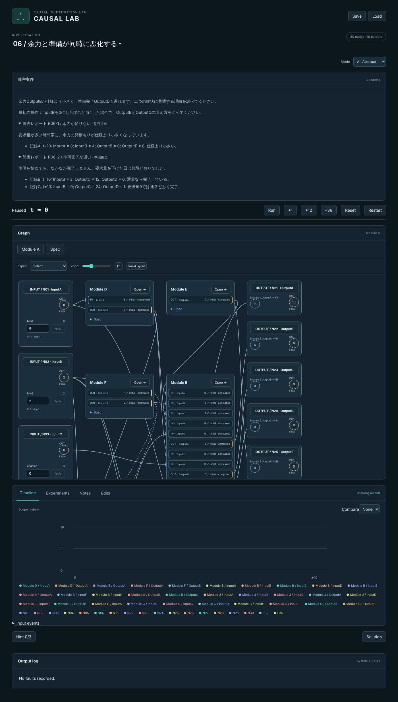
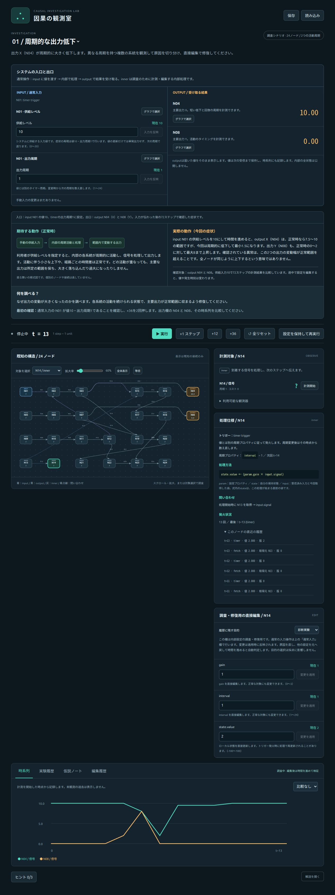

# 因果の観測室 — トリガー方式のPoC

入力・内部処理・問い合わせのイベントを観測し、異常の原因を直接編集して修復するブラウザゲームです。30ノード・3階層・10出力の共通システム1つの上に、練習ページと障害対応ページの2ページを収録しています。障害対応ページでは、下表7件の故障がすべて同時に入ったシステムに、7件の障害レポートがまとめて届きます。アカウント・APIキー・クラウド契約は不要です。

時間操作は Run / Pause / Reset / Restart と表示速度（1x・4x・8x）だけです。1ステップずつ進めるボタンはありません。代わりに、操作を「何tick目に何をしたか」の列として記録・保存し、時刻・値・順序を変えた変種を同じ初期状態から再実行して比べます。仕様は[docs/TIME_CONTROLS_DESIGN.md](docs/TIME_CONTROLS_DESIGN.md)にあります。

## 共通システムと障害案件

| 案件 | 症状 | 障害レポート |
|---|---|---|
| 00 / 練習 | 故障なし。入力の変化が出力に届く時刻を確かめる | 動作確認の依頼 |
| 01 / 周期的に下がる余力 | 余力が12ステップごとに下がる | 余力の低下、準備は正常 |
| 02 / 準備完了が遅れる | 準備量の増え方が遅い | 完了の遅れ、余力は正常 |
| 03 / 二つの換算値がずれる | 変換値と要求の換算値がともに大きい | 出力担当・需要担当の2件 |
| 04 / 大きい供給だけ合わない | 供給が大きいときだけ変換値が頭打ち | 小さい供給と大きい供給の比較 |
| 05 / 値は合うが反映が遅い | 変更の反映が変更時刻によって1〜3ステップ遅れる | 遅れ方の異なる2件 |
| 06 / 余力と準備が同時に悪化する | 余力不足と準備の遅れ。要求量0では消える | 監視担当・準備担当の2件 |
| 07 / ときどき使用結果が0になる | 取り込み・解除・使用の順番で結果が0になる | 異常と正常の記録（操作時刻なし） |

システム・モジュール・出力条件・公開検証ケースはすべての案件で共通です。障害対応ページのレポートは、各案件の隠れた操作記録を7件同時故障のシステムで再生した値を表示し、文面もその値に合わせています。ヒントはレポートごとに開きます。全出力条件を満たすとクリアです。案件ごとの単独故障シナリオ（`caseScenarios`）はテスト用に残していますが、画面からは選べません。設計と解答は`docs/FAULT_CASES_DESIGN.md`にあります。



以下の旧シナリオ00〜08の説明は、エンジンの回帰テスト用フィクスチャ（`src/legacyScenarios.ts`ほか）としての記録です。画面からは選択できません。

## 起動・検証

Node.js 22.12以上の22系、または24系とnpmを使用します。

```sh
npm install
npm run dev
```

表示されたURLを開きます。開発サーバーは配信専用で、計算・セッション保存はブラウザ内です。

```sh
npm test
npm run build
```

`dist/` が静的配信可能な成果物です。

## 3種類のノードとトリガー

ノード型はinput／inner／outputの3種類です。共有データ用の別型はありません。

| 種類 | 処理 | トリガー |
|---|---|---|
| input | 手動設定された値プロパティをそのまま出力。初期値あり | manual：値変更ごとに単発出力。timer：独立した周期プロパティで繰り返し出力 |
| inner | 受信値、処理開始時の問い合わせ結果、自分のプロパティ・状態を宣言式で変換して出力 | input：入力イベントごと。timer：周期ごと。request：他ノードから問い合わせを受けたとき |
| output | 届いた値をそのまま保持・表示 | 受信のみ。追加の計算・配信なし。右端の最終列で終端 |

トリガーの種類はシナリオ定義で指定し、画面から確認できます。手動でノード型やトリガーの種類を変更する編集機能はありません。値・タイマー周期・公開された処理パラメータ・innerのローカル状態は画面から変更できます。

### 発火と時間の規則

- 時間は固定dt=1。**発火していないノードは再計算しません。**
- manual inputは値が変わったときだけ、次のステップで1回出力します。同じ値の再適用では発火しません。1ステップ前に複数回変更した場合も、それぞれの値を別イベントとして送ります。
- timer inputの値を更新しても即時出力しません。次のタイマーで最新プロパティ値を送ります。値と周期は独立しています。
- 初回のtimer発火は開始から1周期後。周期変更時は、その変更時点から新しい周期を数え直します。
- 接続はノード間の関係だけを表し、値を加工しません。通常の出力イベントは共通のスケジューラで次の1ステップに受信側へ届けます。接続ごとの係数・追加遅延・独自状態はありません。同一ステップ内で次々に再帰配信しません。
- input triggerのinnerは、**同じ値でも、受信イベントごとに必ず処理**します。全入力の到着や値の変化は待ちません。同じtickに2件届けば2回処理します。
- 入力値は接続ごとに直近受信値を保持します。処理は、その時点の最新受信値を使います。同じ入力名へ複数接続がある場合は、有効な接続の直近値を合算します。接続を無効にすると受信値と配送待ちイベントを除外します。再有効化後は次の出力・問い合わせで値を取得します。
- 各tickは受信イベントを予定時刻・登録連番順に処理し、その後timerをノードID順に処理します。接続・問い合わせは接続ID順です。ノード配列の登録順で結果は変わりません。
- 出力に同じtickで複数の値が届く場合は順に受け取り、最後の値を画面・時系列に表示します。個々の受信はノード履歴に残ります。

### 共有データの取得

request triggerのinnerを共有データの保持先として使います。接続の `kind: 'request'` は「参照元から利用側へ値を返す関係」です。

利用側のinnerが発火すると、その処理開始時にrequest接続の参照先へ問い合わせます。参照先は自分の処理式を実行して応答し、取得値を利用側の今回のinputに渡します。参照先が更新されても、以前の取得値・処理結果を遡って置き換えません。次の発火で再取得します。

問い合わせは同期的・決定論的で、今回のPoCでは通信待ち時間を持ちません。取得した値はそのまま利用側へ渡します。request接続の循環はスキーマ検証で拒否します。通常のイベント接続の循環は許容します。

参照先のプロパティ／保持状態に変更があると版番号が進みます。取得履歴には、取得元、値、版番号、時刻を記録します。request自身は要求元へ応答するだけで、他の利用側へ勝手に配信しません。

### プロパティと状態

`parameters`は設定値、`initialState`から作る`states`は処理結果・ローカルな記憶です。どちらもinnerの処理式から参照できます。状態の加算・蓄積・追従はinnerの処理として表現し、専用ノード型を増やしません。

公開された`state.value`はユーザーも編集できます。ただし、それだけでは配信しません。次の発火で処理がその状態を使い、必要なら更新します。共有保持先も同じ規則で、例えば`state.value ← param.level`なら手動の状態変更は次の問い合わせ時に上書きされ、`state.value ← state.value`ならそのまま保持します。

## 画面と遊び方

1. グラフ上のinputノードで値を設定します。入力ノードのmanual／timer表示と、独立した出力周期を確認してください。
2. 全ノード・接続を開始時から自動計測し、グラフと時系列に表示します。計測開始操作は不要です。保存データの読み込み時も、その時点から全対象を計測します。
3. 選択したノードの「処理仕様」で、トリガー、処理式、問い合わせ先、次回timer、発火回数、直近の取得履歴を確認します。内部処理はブラックボックスではありません。
4. 「調査・修復用の直接編集」で、設定とローカル状態を変更できます。通常入力と内部編集はAPI・履歴ともに区別します。
5. Run / Pauseで時間を進めて実験します。操作は記録され、Experimentsで実験として保存・再生・編集（変種）・比較できます。予測と結果メモは実験ごとに保存します。
6. 公開した出力条件を満たすよう修正して時間を進めると自動判定します。回答フォーム・修復確定操作はありません。

「期待する動作」は仕組みを抽象的に説明し、出力条件表で値・タイミングを定義します。「現在の出力」は実行時の判定状態を表示し、異常ポップオーバーとログで期待値・実測値を具体的に示します。

| シナリオ | 入力 | 出力と調査内容 |
|---|---|---|
| Tutorial | N01：manual、入力値8から16へ | N03：3ステップ後に8。故障なしの操作練習 |
| 周期的な出力低下 | N01：timer、値10・周期1 | N04とN08の過大な変動。周期的に生成された値がN02での計算に影響 |
| 遅れて現れる異常 | N01.enabledを0から1へ変更して反映 | N04が正常11ステップに対し故障33ステップで切り替わる。 |
| 複数の出力が同時にずれる | N01.level（0〜20の整数） | N16・N17・N18のずれと、正常なN19・N20を比較。共有値を問い合わせる処理を含む20ノード。 |
| 大きな入力だけ合わない | N01.levelを小さい値と大きい値に変更 | 小さい入力では合う一方、大きい入力でN16・N17・N18が条件を外れる。20ノード。 |
| 値は合うが反映が遅い | N01.levelを14などへ変更して反映 | 最終値ではなく反映時刻のずれを調べる。回復後も異常ログを確認可能。20ノード。 |
| 数値と時間に現れるずれ | 上位の入力値を8へ変更して反映 | 12ノード。Coreを展開すると4モジュールが現れ、数値出力と時間出力の症状を仕様と境界観測で照合する。 |

任意ヒントは3段階。解説は自動クリア時、または確認付きの明示開示でのみ表示します。手動開示はREVEALEDで、通常クリアと区別します。



## リセットと保存

- 全リセット：初期プロパティ・状態・故障条件へ戻り、イベントキュー・timer位相・発火履歴・編集履歴も初期化します。ノート・記録済み実験は保持します。
- 設定を保持して再実行：設定値・修復編集を保持して時刻を初期化します。手動編集した状態値は初期状態として再適用し、それ以外の状態はシナリオの初期値へ戻します。manual inputが初期値と異なる場合、その値をt=0の操作として再送します。timerは新しいt=0から周期を数え直します。すでに発生したパラメータ故障は再注入しません。
- 保存／読み込み：localStorageのv12スロットへ保存します。イベントキュー、受信値、timer位相、履歴・版番号も含むので同じ続きになります。旧v1〜v11は互換性がなく読み込みません。旧スロット自体は削除しません。

## 出力条件による判定

`Scenario.outputRequirements[].rules`が異常通知とクリア判定の共通定義です。画面には期待動作の説明に加え、実際に使う判定式・入力時刻・検証期間・外乱シードを公開します。条件表は初期状態で折りたたみ、固定の再現結果は表示しません。

各ステップで、出力範囲・入力との関係・周期位相・応答期限を確認します。異常がある出力には独立した非モーダルのポップオーバーが自動表示され、回復すると消えます。表示中もグラフを操作できます。ポップオーバーはノードが画面内にあるとき表示します。発生・回復のログは画面最下部に残り、複数ステップ進めた途中の異常も失われません。同じ異常が持続している間は毎ステップ記録しません。

現在の全出力が連続stableSteps（tutorial6、既存調査36、追加調査24）正常なら、編集した設定を使って公開検証ケースを初期状態から再生します。周期シナリオは供給0/1/4/10/20と供給変更、外乱の複数シード、遅延シナリオはN01.enabledを1または0に変更する時刻と、0を維持した場合を検証します。全ケースの全出力条件が通ればクリアです。検証結果は実験中の世界やログを変更しません。

特定の原因箇所・編集履歴の目的・内部設定の初期値は正解条件ではありません。同等の出力動作を実現する補償も正解です。手動の状態編集も、その変更を初期状態へ適用して検証するため、一時的に最終値だけを合わせた変更は応答期限などで検出します。条件違反が新たに発生すれば検証完了状態も取り消します。元の故障原因は解説専用です。接続の追加・接続先変更の編集機能は未実装で、既存接続の有効・無効のみ編集可能です。計算や遅延はノードの責務です。

## コード構成と追加方法

- `src/engine.ts`：React非依存のイベントエンジン、スキーマ検証、問い合わせ・編集・修復判定。
- `src/cases/system.ts`：共通システム。ノード、接続、階層・モジュール仕様、Mode A/Bの意味情報、出力条件、公開検証ケース。
- `src/cases/index.ts`：障害案件（故障・障害レポート・ヒント・解説）と、共通システムとの合成。
- `src/faultReports.ts`：障害レポートの型。レポートの値は、隠した操作記録を故障ありのシステムで再生して求めます。
- `src/legacyScenarios.ts` / `src/additionalScenarios.ts` ほか：旧シナリオ。エンジン回帰テスト用のフィクスチャ。
- `src/scenarioBuilders.ts`：ノード・接続・観測・編集項目の共通定義。
- `src/App.tsx`：セッション、実行、記録、保存、解説。
- `src/Graph.tsx`：ノード上でのinputプロパティ入力とoutputの受信値常時表示。
- `src/NodeDetails.tsx`：処理仕様と問い合わせ・発火の可視化。
- `src/Editor.tsx` / `src/Graph.tsx`：状態・設定の編集とグラフ表示。
- `WORK_LOG.md`：作業進捗・判断・検証と引き継ぎ。
- `POC_EVALUATION.md`：実装者によるゲーム性の所見（解を含みます）。

新シナリオはScenarioデータとして追加します。innerのupdateには数値、`{ref:'state.value'}` / `param.level` / `input.signal` / `time`、`{op,args}`を使います。evalはありません。sum/multiply/clamp/threshold/delay/integrator/filter/switch/pulseを合成でき、加算・蓄積・条件変換は処理式の一部です。同一発火の式内state参照は処理開始直前の状態です。

inputではinputParameterで出力値を指定し、trigger.typeをmanualまたはtimerにします。timerには正の整数の周期プロパティとperiodParameter名が必要です。innerはinput/request/timer、outputは受信のみです。request接続の参照先はrequest-innerにしてください。outputは必ず最終列・出る接続なしです。

Faultはパラメータの一度だけの異常化、または発火／配信時の状態変換として適用します。パラメータ故障をユーザーがフラグで消す機能はなく、同じ計算規則のパラメータを編集して修復します。新しいデータには正常／異常の比較、正しい修復、同等な補償の受理と不十分な修正の拒否、トリガーの再現テストを加えてください。

## 検証と限界

既存の修復・シナリオ・UIテストに加え、各トリガーの発火回数、同値イベント、共有データの取得時点、手動状態更新、循環、安全な失敗、キューを含む保存再現を自動テストしています。ブラウザでもmanual単発、timer周期変更、共有データ更新後の次回取得、処理式・版番号履歴を確認しています。CI向けの自動操作E2Eは未実装です。

timer周期とノード故障による出力遅延は上限512ステップ。1tickの受信は最大20,000件、待機キューは最大50,000件で、超過時は元の状態を保って安全にエラー表示します。ノードの直近発火・取得履歴は全体で400件、計測・実験記録はセッション中保持します。極端に長いセッションには間引きが必要です。

requestは同期取得で、非同期通信・処理中の待機状態・トランザクション・入力のjoinは実装しません。版番号はノードの公開プロパティ／状態の改訂を表し、永続DBの厳密なトランザクション番号ではありません。任意の外部JSONを完全に検証するインポート機能はありません。初見プレイテストは未実施です。

SHOULDのヒント・セッション保存・実験比較は実装済み。線で結ぶ任意の因果マップは未実装で、ノートで代替しています。

グラフのノードをクリックすると、計測・処理仕様・直接編集の詳細がノード付近のポップオーバーで開きます。inputはノードの見出しから開き、プロパティ入力欄はグラフ上で操作します。グラフを操作したまま別のノードに切り替えられ、閉じるボタン、Escape、外側のクリックで閉じられます。接続や対象選択からも詳細を確認できます。グラフの空いている背景をドラッグすると縦横にスクロールできます。

各シナリオにはoutputへ至る有向経路を持つノードだけを配置しています。出力に影響しない監視枝は削除済みです。現在の保存形式はv12です。旧v5/v6保存は保持されますが読み込みません。

グラフの入力・出力ポートは最後に完了した計算の組を表示します。新しい値が届いても、次の計算完了までは両方の表示を保持します。状態や設定の編集だけでも表示の組は変わりません。初期表示は設定された初期値です。入力値は送信元の出力をそのまま使い、同じ入力先の値は受信ノード内で加算します。

期待動作は「出力ごとの動作条件」表で、対象output・入力条件・許容値・応答時間・維持条件を明示しています。個別の入力例ではなく、入力範囲に対する一般的な条件です。再現時の固定結果は表示せず、実行時の異常ポップオーバーとログで通知します。

- 周期シナリオ：N04・N08の計算結果と、N13・N14の周期的な値の変化を表示します。N13・N14は故障中も期待する値と周期を保ちます。
- 遅延シナリオ：N01.enabledを変更するとN13は2ステップ後に同じ値となり、N04は条件表に示した時刻に変わります。N14は常時−0.05です。N13・N14は故障中も期待動作を保ちます。

採点は公開された出力条件と検証ケースのみで行います。旧形式の保存スロットは保持しますが、互換性がないデータは読み込みません。

## 編集できない外乱INPUT

INPUTは手動入力と外部入力を区別します。外部入力はNode.externalInputを持ち、プレイヤー用のinputs/interventionsには登録できません。画面では「外乱・編集不可」と表示し、値・生成方法・発火間隔・シード・状態の操作欄を出しません。setInput/interveneも外部入力の変更を拒否します。外部入力の値・発火履歴は常時計測できます。

値と発火時刻は独立です。externalInput.valueはuniform(min,max)またはfixed(value)、triggerはtimer（interval等の固定プロパティ）またはrandom（整数minInterval〜maxInterval、両端を含む）を指定します。uniformは下限以上・上限未満、発火間隔は1〜512ステップです。初回発火も1周期または最初のランダム間隔を待ちます。発火間は最後の値を保持します。

シードは0〜4294967295の整数。ノードごとに独立した値・時刻用の乱数状態をWorld.randomへ保存します。Math.randomは使いません。保存・再開は同じ続き、全リセットと設定保持の再実行は同じ外乱列を最初から再生します。他ノードの実行順や問い合わせで外乱列は変わりません。

周期シナリオへN15（外部負荷、0〜0.4、ランダム3〜7ステップ間隔）を追加しました。N16がN03の値から外乱N15の値を引き、N17がその結果、N18がN15の値を表示します。元のN04/N08の症状は維持しています。N17の正常範囲はmax(0,N01.capacity−2.9)〜N01.capacityです。全ノードはoutputへ至る経路を持ちます。定周期の外乱もエンジンとテストで対応しています。

保存形式v12は乱数状態と追加ノードを含みます。旧v8スロットは保持し、互換性のない保存は読み込みません。

保存形式v12は出力判定の履歴・現在の異常・発生／回復ログ・ケース検証結果を保存します。旧v9/v10/v11データは別スロットに保持されます。

接続は値を変換しません。「遅れて現れる異常」の減衰はN05.gain（故障時0.2）によるノードの計算です。E04はN05.outputをそのままN06へ渡します。保存形式v12へ更新し、接続に処理を持つ旧v10保存は読み込みません。

遅延シナリオのN06はE25でN01の値を受け取り、0なら蓄積を0へ戻します。これによりN01.enabledを繰り返し0→1へ変えた場合も、正常時のN04の応答時間は11ステップです。公開検証ケースには繰り返し変更も含みます。

保存形式v12ではN06へのN01の接続E25を追加したため、旧v11の保存は読み込みません。旧スロットはそのまま保持します。

## 追加した問題（03〜05）

各20ノード・5出力です。N16・N17・N18の値と応答時刻を調査し、独立した経路のN19・N20も正常に保ちます。N05はrequest triggerで共有値を返します。接続は値を加工しません。期待条件は0〜20の整数入力と、入力後の4〜6ステップの伝播を対象にしています。7種類の入力値と、操作時刻を1・3・6にずらした連続変更を公開検証ケースに含めています。新規問題の追加だけなので既存のv12保存は互換性を保ちます。

## 階層型の調査（06 / 数値と時間に現れるずれ）

全問題で、開始画面はINPUT → Core → OUTPUTを表示します。CoreはINNER全体をまとめたモジュールです。06ではCoreを展開するとSampler・Transform・Timing・Referenceが現れ、ReferenceにはShared factorが含まれます。表示中のモジュールだけ仕様と境界値を確認できます。パンくずと「親階層へ戻る」で折りたたみます。直接所属ノードを表示した階層では、処理式・ローカル状態・設定を確認して編集できます。

グラフ内のINPUTで値を操作します。開始画面のOUTPUTは最後の列に配置し、内部の階層ではシステム最終出力を上部にも表示します。異常通知・ログ・採点は最終出力だけを対象とします。モジュールの正常・異常を自動で色分けせず、子の故障箇所も強調しません。

境界の入力値は受信先の最後の計算で使った値、出力値は最後の計算結果です。各ポートの時刻は独立です。初期値や手動設定値とも区別します。requestの観測は最後の取得結果を示し、閲覧のために再取得しません。境界は値を加工せず、遅延も追加しません。

シミュレーションと記録は非表示のノードでも継続します。時系列・実験比較で閲覧できる系列は現在の階層に限定し、展開すると以前の履歴も読めます。対象一覧・数式の外部参照・ヒント・検証結果でも未展開の内部IDを表示しません。開発者ツールや配信ソースを秘匿する仕組みではありません。

- `src/moduleView.ts`：全問題のSystem/Core所属と境界、共通形式の入出力仕様を生成する表示アダプター。実行ノードを変更しません。
- `src/hierarchy.ts`：所属木、境界と観測、接続の投影、閲覧範囲とモデル検証。
- `src/hierarchyScenario.ts`：新規問題、モジュール仕様、公開出力条件と検証ケース。
- `src/HierarchyPlay.tsx` / `src/HierarchyGraph.tsx` / `src/ModuleDetails.tsx`：階層UI、公開入力・出力、仕様と観測、調査と修理。
- `src/hierarchySession.ts`：階層表示と実行状態の保存検証。`src/HierarchyOutputs.tsx`：最終出力と通知。
- `src/expressionFormat.ts`：ノードとモジュール仕様に共通の宣言式の表示。
- [設計・調査経路・自己評価](docs/HIERARCHY_DESIGN.md)：設計者向け。解答を含み、ゲーム内ではクリア前に表示しません。

全問題の現行UIは `causal-hierarchy-session-v14` に表示階層、境界を含む調査対象、詳細の開閉、ゲーム状態、計測・実験・ノートを保存します。旧v12/v13スロットは保持し、階層・選択IDが異なるため現行UIでは読み込みません。ノード・モジュール・境界INPUT/OUTPUTはカードや見出しをドラッグして移動できます。階層ごとの配置はSave/Loadに含め、Reset layoutは現在の階層だけを初期配置へ戻します。ズームとスクロール位置は保存しません。

独立したOutput specセクションは廃止し、Systemも子も同じModuleSpec.outputsとSpec表示を使います。子の仕様は親を展開してグラフ上に現れた時点で確認できます。境界のINPUT/OUTPUTは受け渡し専用の表示ノードで、既存のINNERを改種別しません。

階層は表示・仕様のレイヤーであり、実行は従来のフラットなグラフです。モジュール仕様は調査用で、正解条件へ追加しません。元の原因を直接編集する修理に加え、別の二つの処理を補償する修理も、システムの全公開ケースを満たせば受け入れます。

実装者による操作確認は実施済みですが、初見プレイテストは未実施です。階層化で面白さを実証したとは主張しません。共通の依存先を先に調べて解く方法もあり、必ず洞察を経由するとは保証できません。

## 機能的意味の比較（07 / Two deviations）

07は15ノード・5出力の専用問題です。ModeのA · AbstractではModule／Input／Outputの識別名と数理仕様、B · Functionalでは機能名・目的・入出力の役割・前提・制約を表示します。実行グラフ・故障・外乱・観測範囲・編集範囲・動作条件は共通です。切り替えても時刻や状態、階層、実験・ノート・配置は維持し、Save/Loadにはモードも含めます。旧v14保存も読み込めます。

試すには07を選び、N03.enabled（InputC / Enable）を1にしてApplyし、5ステップ進めます。Module B / Coordinationを開き、余力の見積もりと準備量の増加を比較できます。既存00〜06はそのまま維持しています。A/B比較用の意味定義は今回07に実装しています。

`src/semanticModel.ts`は固定の機能型を持たない宣言的な意味情報、`src/semanticPresentation.ts`は表示だけの投影、`src/semanticScenario.ts`は問題・階層・数理仕様・意味情報を定義します。Simulation Coreの新しいノード型や処理は追加していません。

意味による仮説発見の改善は、実装しただけでは確認できません。[設計・実装者評価・プレイヤーテスト計画](docs/SEMANTIC_DESIGN.md)に、解答を含む調査経路、定量仕様、観測できる事実と未検証事項を記録しています。

## 08 / Intermittent output — 再現条件の探索

08は8ノード・2出力の追加問題です。`Report / partial records`に断片的な正常・異常の観測を掲載しています。完全な再現手順は初期説明に表示しません。Mode A/B、上位からの階層展開、ノード編集は07と共通です。各入力の意味と最終出力の応答期限はSystemのSpecで確認できます。

- グラフの入力を操作し、Run / Pauseで間隔を変えます。Timelineの縦線と`Input events`で操作時刻・内容を確認できます。
- 操作はReset・Restart・「ここから記録し直す」の時点から自動で記録されます。`Experiments → 実験として保存`で、開始時のWorld全体（状態・設定・キュー・外乱の乱数状態）、tick付きの入力・介入・手動request、実験名・事前予測を保存し、結果（時系列・出力ログ・出力ごとの異常/回復時刻）を計算します。
- `再生`は現在のセッションとは別のWorldで、記録した開始状態から同じ操作を同じtickに実行します。再生中は次の予定操作と完了・失敗を表示し、直接の操作は受け付けません。`セッションに戻る`で元の状態に戻ります。
- `操作シーケンスを編集して変種を作る`で時刻・値・順序を変え、`変種として実行`で元の実験を変えずに対照実験を追加します。比較表と時系列の破線で比べてください。
- Save/Loadは保存形式v15です。v14の保存も読み込み時に変換します（旧データは消しません）。

判定は最終出力条件と18種類の検証ケースのみです。再現の発見、原因の回答、特定ノードの修正は合格条件にしません。再現機構は既存の保持状態・switch・timerの宣言的な組み合わせで、エンジンにシナリオ専用処理を追加していません。

開発者向けの再現手順・対照実験・修理方法・評価上の限界は [docs/REPRODUCTION_DESIGN.md](docs/REPRODUCTION_DESIGN.md)（ネタバレ）を参照してください。初見プレイヤーのAha体験や難易度は未検証です。
